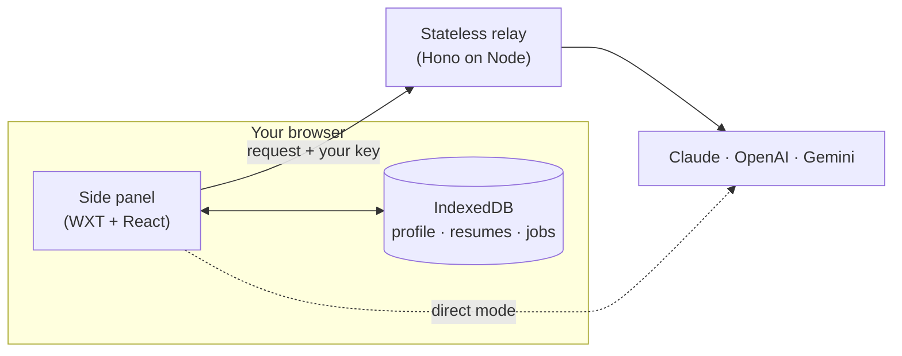

<div align="center">

# Slayply

**Slay every application.**

A personal Chrome side panel that turns a job description and its application questions into answers, cover letters and messages written from your real background, with your choice of LLM.

[](https://github.com/devnadeemashraf/slayply/actions/workflows/ci.yml)
[](LICENSE)


[Honest status](#honest-status) · [Try it](#try-it) · [Disclaimer](#disclaimer) · [How it works](#how-it-works) · [Principles](#principles) · [Privacy](#privacy) · [Development](#development)

</div>

## Honest status

Everything on the roadmap is built, and a relay and landing site are live. It has had **one real-world test**: answer generation worked end to end with a real Gemini key, slowly. Beyond that it is lightly tested:

Free LLM credits turned out to be a myth, and the companies that sell tokens by the gram have not been moved by this project's plight. So almost all testing uses fake credentials and stubbed providers. The capture, profile, claim-checking, saving and copy flow is covered by an automated suite and a Chromium smoke test, and the relay streams correctly against a stand-in model.

- **Known problem:** a fit check on a slow thinking model (Gemini 3 Flash on low effort) ran past the relay's two-minute limit and showed an error, with no progress shown while waiting. The error now explains itself and offers a retry; progress indication and the cause are the next fixes.
- **Never tried live:** Claude and OpenAI replies, model lists and reasoning-effort settings were written from the vendors' documentation. Gemini model lists and effort settings are only partly confirmed.
- **Checked by hand on a few pages only:** the panel's look and capture on real Workday, Oracle and Lever pages.

So please do not call this production-ready. Call it **a finished build that needs a brave tester**. If you have Claude or OpenAI credits and ten spare minutes, running one real generation and [opening an issue](https://github.com/devnadeemashraf/slayply/issues/new) with what broke (or "it worked!") would be a huge help, and you will have this author's sincere and slightly desperate gratitude. Never paste your API key into an issue.

## Try it

- **Site and privacy page:** https://slayply-site.onrender.com
- **Relay:** https://slayply-relay.onrender.com (the free tier sleeps, so the first request after a pause can take up to a minute; the panel says "waking the relay" while it waits)
- **Download:** [slayply-extension.zip](https://github.com/devnadeemashraf/slayply/releases/latest/download/slayply-extension.zip) from the latest GitHub release (a SHA-256 checksum sits beside it). Unzip it, open `chrome://extensions`, turn on **Developer mode**, choose **Load unpacked** and pick the unzipped folder. It is not on the Chrome Web Store, so Chrome will not update it: download the new zip to update. Read the [disclaimer](#disclaimer) first.
- **Or build it yourself:**

  ```bash
  pnpm install
  WXT_RELAY_URL=https://slayply-relay.onrender.com pnpm --filter @slayply/extension build
  ```

  Then open `chrome://extensions`, turn on Developer mode, choose **Load unpacked** and pick `apps/extension/.output/chrome-mv3`.
- **Relay access:** the extension has a fixed ID (`iljnmipngombklkmmjlfgbgdbnagbnbn`) on every machine, so the hosted relay accepts it wherever you unzip it. If you run your own relay, list that ID in `EXTENSION_IDS`.
- Direct Mode (Claude only) skips the relay and calls Anthropic from your browser.

---

## Why

Job applications ask the same questions in slightly different words, and generic AI drafts read like generic AI drafts. Worse, they invent things: a metric you never hit, a tool you never used.

Slayply does the opposite. You keep one profile of real facts. Every sentence it writes about you has to point back to one of them, and anything it can't back up is flagged in red for you to remove.

## How it works

1. **Browse as usual.** You find the job yourself.
2. **Capture.** Click the Slayply icon (or press Alt+Shift+S) on a job page. The job description and the application questions land in the side panel for you to review, edit and generate from. You can also select text and send it, or paste it in.
3. **Fit check.** Slayply matches the role against your profile and picks the right resume: what they want, what you have, the gaps, your odds, and any deal-breakers like location or visa.
4. **Generate.** Answers that respect character limits, plus a cover letter, a recruiter message, a cold email or a relocation note. Adjust tone (crisp, warm, bold) and length.
5. **Check the claims.** Each sentence cites a fact ID such as `F01` or `S03`. Uncited ones are highlighted.
6. **Copy, paste, submit.** You do the last step yourself, every time.

## Principles

| | |
| :-- | :-- |
| **You drive** | No auto-fill, no auto-submit, no background scraping. Slayply never writes into a page. |
| **Local first** | Profile, resumes, jobs, history and API keys stay in your browser. |
| **Grounded** | Every claim about you cites a fact from your profile. No invented numbers, titles or employers. |
| **Bring your own model** | Claude, ChatGPT and Gemini, with reasoning-effort controls where the model supports them. |
| **Honest by default** | If a question tries to detect AI-written answers, the reply discloses that a human applied and AI assisted the draft. |

On LinkedIn, Slayply reads only the text you explicitly select, in line with LinkedIn's User Agreement. On other boards it reads the visible job description and the labels of the questions (never what you have typed into them) only when you click the icon, press the shortcut or use the menu, and only on the tab you invoke it on. Other sites, and frames from other sites, need access you grant once per site or in one go for popular job boards in Settings. Slayply never asks for access to LinkedIn and never writes into a page.

## Privacy

> Your profile, resumes, saved jobs, history and API keys live only in this browser. When you ask for a draft, the text needed for it (job description, questions, relevant profile facts, chosen resume) is sent through the Slayply relay to the LLM provider you picked. The relay keeps nothing. The provider's own data policy applies to what it receives.

- **No telemetry, no accounts, no cloud sync.**
- **One public lookup.** On a Greenhouse job page, with job sites allowed, capture also asks Greenhouse's public job API for that job's questions. Only the board name and job number from the page address are sent, with no cookies or keys.
- **The relay is stateless.** No database, no stored prompts, and no request or response bodies in its logs. Your key travels in a header for a single request and is not retained.
- **Prefer no relay at all?** Direct mode calls the provider straight from the extension.

## Disclaimer

Slayply is free, open-source software (MIT licence), provided **as is**, without warranty of any kind. You use it at your own risk.

- **Not affiliated.** Slayply is not affiliated with, endorsed by or sponsored by Anthropic, OpenAI, Google, LinkedIn, Greenhouse, Lever, Ashby, Workday, Oracle or any employer. Their names and trademarks belong to their owners.
- **AI can be wrong.** You are responsible for reading, correcting and submitting everything that carries your name. The claim check helps but does not guarantee accuracy. Never state anything untrue in an application.
- **Your accounts and costs.** You are responsible for following the terms of the websites you use it on, of employers and recruiters, and of your AI provider, and for any charges on your API key. Some provider plans may train on what you send.
- **No guarantees.** It does not promise interviews, offers or any outcome. It is not legal, career or professional advice.
- **Limit of liability.** To the fullest extent the law allows, the author is not liable for any loss or damage from using it, including lost opportunities, rejected applications, account action by a third party, API charges or lost data. Back up your data from Settings.
- **The hosted relay is a courtesy.** It is free, has no uptime promise and may be stopped at any time. You can run your own.
- **Downloads are unsigned.** The prebuilt zip is not from the Chrome Web Store and is not code-signed. Check its SHA-256 against the value on the release page, or build it from source.

## Architecture



| Package | Purpose |
| :-- | :-- |
| `apps/extension` | Chrome side panel, Manifest V3 (WXT, React) |
| `apps/relay` | Stateless Hono server that forwards LLM calls and streams the reply |
| `apps/site` | Static landing and privacy pages |
| `packages/core` | Zod schemas, validators, prompt builder and claim checker |
| `packages/providers` | One adapter per LLM behind a single interface |
| `packages/ui` | Shared components and themes |

## Roadmap

| Phase | Focus | Status |
| :-- | :-- | :-- |
| 0 | Bootstrap: monorepo, checks, hooks, CI | Done |
| 1 | Shared contract, relay, side panel shell, first generation loop | Done |
| 2 | Profile, resume parsing, fit check, claim checker, settings and backup | Done |
| 3 | OpenAI and Gemini, effort controls, direct mode | Built; Gemini tried live, Claude and OpenAI never |
| 4 | Capture, job history, cover letters and messages | Done |
| 5 | Themes, site, security review, release prep | Done; v1.0.0 not tagged until real-key testing |

Item-level detail lives in [`docs/ROADMAP.md`](docs/ROADMAP.md); the product definition is [`docs/SPEC.md`](docs/SPEC.md).

## Development

**Requirements:** Node 24.21+, pnpm 12.6+, Git 2.50+. Chrome 114+ for the Side Panel API.

```bash
git clone https://github.com/devnadeemashraf/slayply.git
cd slayply
pnpm install        # also installs the git hooks
pnpm run doctor     # verify your toolchain against the pins
pnpm run check      # doctor, handoff, format, lint, test, typecheck
```

| Command | What it does |
| :-- | :-- |
| `pnpm run check` | Everything CI runs |
| `pnpm run fmt` | Format with Biome |
| `pnpm run lint` | Lint with Biome (warnings fail) |
| `pnpm test` | Tooling tests plus every package's tests |
| `pnpm run loadtest` | 5,000 streamed requests through the relay against a stub model (about 10k requests/s, p99 under 30 ms on a laptop) |

Work is split into small roadmap items, one PR each, on branches named `<type>/<ID>-<slug>` with Conventional Commit messages. Start with [`AGENTS.md`](AGENTS.md) for the workflow, [`docs/CODING_STANDARDS.md`](docs/CODING_STANDARDS.md) for style, and [`docs/SETUP.md`](docs/SETUP.md) for a full walkthrough.

## Documentation

- [Specification](docs/SPEC.md) · [Roadmap](docs/ROADMAP.md) · [Handbook](docs/HANDBOOK.md)
- [Coding standards](docs/CODING_STANDARDS.md) · [Pinned versions](docs/VERSIONS.md) · [Legal notes](docs/LEGAL.md)
- [Architecture decisions](docs/adr/)

## License

[MIT](LICENSE) © 2026 Nadeem Ashraf
