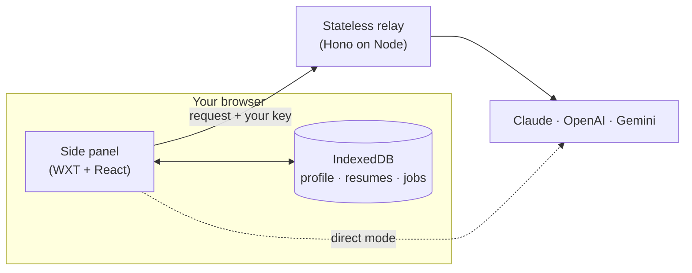

<div align="center">

# Slayply

**Slay every application.**

A personal Chrome side panel that turns a job description and its application questions into answers, cover letters and messages written from your real background, with your choice of LLM.

[](https://github.com/devnadeemashraf/slayply/actions/workflows/ci.yml)
[](LICENSE)


[How it works](#how-it-works) · [Principles](#principles) · [Privacy](#privacy) · [Roadmap](#roadmap) · [Development](#development)

</div>

> [!NOTE]
> Slayply is **pre-release**. The shared contract (`@slayply/core`) is built; the relay, side panel and provider adapters are in progress. Nothing here is installable yet. See the [roadmap](#roadmap) for where things stand.

---

## Why

Job applications ask the same questions in slightly different words, and generic AI drafts read like generic AI drafts. Worse, they invent things: a metric you never hit, a tool you never used.

Slayply does the opposite. You keep one profile of real facts. Every sentence it writes about you has to point back to one of them, and anything it can't back up is flagged in red for you to remove.

## How it works

1. **Browse as usual.** You find the job yourself.
2. **Capture.** Select the job description or the questions and send them to the side panel (or paste them in).
3. **Fit check.** Slayply matches the role against your profile and picks the right resume: what they want, what you have, the gaps, your odds, and any deal-breakers like location or visa.
4. **Generate.** Answers that respect character limits, plus a cover letter, a recruiter message, a cold email or a relocation note. Adjust tone (crisp, warm, bold) and length.
5. **Check the claims.** Each sentence cites a fact ID such as `F01` or `S03`. Uncited ones are highlighted.
6. **Copy, paste, submit.** You do the last step yourself, every time.

## Principles

| | |
| :-- | :-- |
| **You drive** | No auto-fill, no auto-submit, no background scraping. Slayply never writes into a page. |
| **Local first** | Profile, resumes, jobs, history and API keys stay in your browser. |
| **Grounded** | Every claim about you cites a fact from your profile. No invented numbers, titles or employers. |
| **Bring your own model** | Claude, ChatGPT and Gemini, with reasoning-effort controls where the model supports them. |
| **Honest by default** | If a question tries to detect AI-written answers, the reply discloses that a human applied and AI assisted the draft. |

On LinkedIn, Slayply reads only the text you explicitly select, in line with LinkedIn's User Agreement. On other boards it may read the visible job description, and only when you press Capture.

## Privacy

> Your profile, resumes, saved jobs, history and API keys live only in this browser. When you ask for a draft, the text needed for it (job description, questions, relevant profile facts, chosen resume) is sent through the Slayply relay to the LLM provider you picked. The relay keeps nothing. The provider's own data policy applies to what it receives.

- **No telemetry, no accounts, no cloud sync.**
- **The relay is stateless.** No database, no stored prompts, and no request or response bodies in its logs. Your key travels in a header for a single request and is not retained.
- **Prefer no relay at all?** Direct mode calls the provider straight from the extension.

## Architecture



| Package | Purpose |
| :-- | :-- |
| `apps/extension` | Chrome side panel, Manifest V3 (WXT, React, Tailwind) |
| `apps/relay` | Stateless Hono server that forwards LLM calls and streams the reply |
| `apps/site` | Static landing and privacy pages |
| `packages/core` | Zod schemas, validators, and later the prompt builder and claim checker |
| `packages/providers` | One adapter per LLM behind a single interface |
| `packages/ui` | Shared components and themes |

## Roadmap

| Phase | Focus | Status |
| :-- | :-- | :-- |
| 0 | Bootstrap: monorepo, checks, hooks, CI | Done |
| 1 | Shared contract, relay, side panel shell, first generation loop | Done |
| 2 | Profile, resume parsing, fit check, claim checker, settings and backup | Done |
| 3 | OpenAI and Gemini, effort controls, direct mode | In progress (adapters done, Direct Mode in review) |
| 4 | Capture, job history, cover letters and messages | Planned |
| 5 | Themes, site, security review, v1.0 | Planned |

Item-level detail lives in [`docs/ROADMAP.md`](docs/ROADMAP.md); the product definition is [`docs/SPEC.md`](docs/SPEC.md).

## Development

**Requirements:** Node 24.21+, pnpm 12.6+, Git 2.50+. Chrome 114+ for the Side Panel API.

```bash
git clone https://github.com/devnadeemashraf/slayply.git
cd slayply
pnpm install        # also installs the git hooks
pnpm run doctor     # verify your toolchain against the pins
pnpm run check      # doctor, handoff, format, lint, test, typecheck
```

| Command | What it does |
| :-- | :-- |
| `pnpm run check` | Everything CI runs |
| `pnpm run fmt` | Format with Biome |
| `pnpm run lint` | Lint with Biome (warnings fail) |
| `pnpm test` | Tooling tests plus every package's tests |

Work is split into small roadmap items, one PR each, on branches named `<type>/<ID>-<slug>` with Conventional Commit messages. Start with [`AGENTS.md`](AGENTS.md) for the workflow, [`docs/CODING_STANDARDS.md`](docs/CODING_STANDARDS.md) for style, and [`docs/SETUP.md`](docs/SETUP.md) for a full walkthrough.

## Documentation

- [Specification](docs/SPEC.md) · [Roadmap](docs/ROADMAP.md) · [Handbook](docs/HANDBOOK.md)
- [Coding standards](docs/CODING_STANDARDS.md) · [Pinned versions](docs/VERSIONS.md) · [Legal notes](docs/LEGAL.md)
- [Architecture decisions](docs/adr/)

## License

[MIT](LICENSE) © 2026 Nadeem Ashraf
