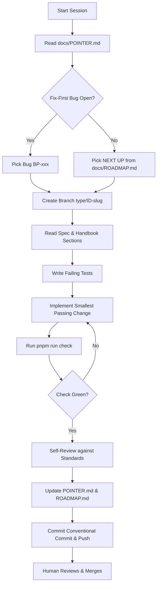

# Slayply AI Workflow & Harness Integration

This guide details how autonomous and pair-programming AI coding agents (Antigravity, Claude Code, Cursor, Copilot) interact with the Slayply codebase.

---

## 1. Core Principles

- **Tool-Agnostic Core:** `AGENTS.md` is the single authoritative source of instructions. Tool-specific files (`CLAUDE.md`, `.cursor/rules/main.mdc`, `.github/copilot-instructions.md`) import or reference `AGENTS.md`.
- **Handoff Pointer First:** Every session begins by reading `docs/POINTER.md`. The `FIX-FIRST QUEUE` has absolute priority over new feature items in `NEXT UP`.
- **No Hidden Context:** All decisions, architecture choices, and version facts are persisted in markdown files within `docs/`.

---

## 2. Session Lifecycle

---

## 3. Tool Harness & Integrations

### Antigravity / CLI Harness
- **Context Injection:** `AGENTS.md` and `docs/POINTER.md` provide instant context on initialization.
- **Verification Rule:** Agents run `pnpm run check` before concluding any turn.
- **Subagent Roles:**
  - `architect`: Evaluates schema trade-offs and draft ADRs.
  - `reviewer`: Checks diffs against `docs/CODING_STANDARDS.md`.
  - `red-team`: Identifies input bypasses, rate limit issues, and unverified claims.

### Claude Code Integration (`CLAUDE.md`)
- Defines shortcuts for `/next-pr`, `/handoff`, and `/review`.
- Hooks intercept commits to verify `docs/POINTER.md` modifications.

### Cursor & Copilot Integration
- Rule files in `.cursor/rules/main.mdc` and `.github/copilot-instructions.md` direct the LLM to adhere to the PR Loop and CODING_STANDARDS.

---

## 4. API Reference Verification
To avoid hallucinated APIs, agents must inspect installed definitions or check live package dist-tags:
- Check exported types directly in `node_modules/<pkg>/dist` or package index.
- Use `pnpm view <pkg> version` or official docs rather than guessing arguments.
- Document any verified facts in `docs/VERSIONS.md`.
