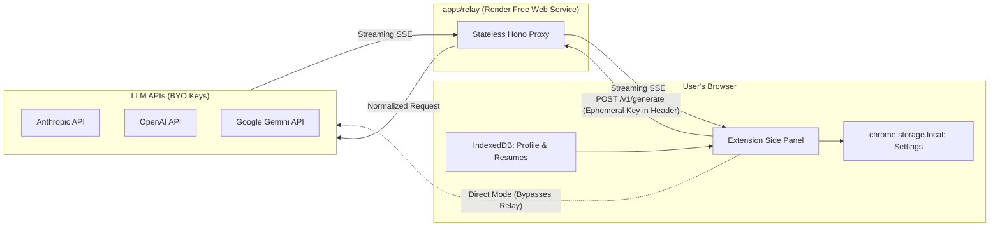

# Slayply Developer Handbook

## 1. Orientation
Welcome to **Slayply**. Slayply is an open-source, privacy-first personal Chrome side panel extension built to help job seekers turn job descriptions and application prompts into grounded, honest answers, cover letters, and outreach messages using their choice of LLM (Claude, ChatGPT, or Gemini).

### Core Tenet
**Zero automation, full agency.** Slayply never fills out forms or scrapes background tabs autonomously. The user browses, captures target text, generates grounded drafts, and manually copies answers into job portals.

---

## 2. Glossary
- **Context Pack:** A single Markdown file containing user facts, stories, and application preferences.
- **Fact ID:** A persistent identifier (e.g. `F01`, `S02`) attached to an experience bullet or project story.
- **Claim Check:** The deterministic verification step ensuring every statement in a generated response cites an authentic Fact ID.
- **Relay:** A stateless proxy service (`apps/relay`) running on Render that bridges extension requests to LLM provider APIs without persisting keys or text.
- **Direct Mode:** An optional client-side mode where the extension communicates directly with provider APIs, bypassing the relay entirely.
- **WXT:** Next-generation Web Extension Framework powered by Vite and Rollup.

---

## 3. Repo Map
```
slayply/
├── apps/
│   ├── extension/       # Chrome Side Panel MV3 extension (WXT + React + Tailwind)
│   ├── relay/           # Stateless Hono proxy server on Render (Node.js)
│   └── site/            # Static landing page & privacy documentation (planned, SITE-01)
├── packages/
│   ├── core/            # Zod schemas and validators (CORE-01), prompt builder (CORE-03); claim checker (planned)
│   ├── providers/       # LLM provider adapters: Claude (PROV-01), OpenAI (PROV-02) and Gemini (PROV-03) built
│   └── ui/              # light/dark theme tokens and base components, shared with the site (REDO-01, ADR-0022)
├── docs/                # Spec, roadmap, standards, handoff pointer; docs/adr/ holds decisions
├── .claude/             # Claude Code hooks config, skills and subagents
├── scripts/             # Workspace doctor, validation, and handoff scripts
├── .github/             # CI workflows and PR templates
├── .githooks/           # Git pre-commit, commit-msg, and pre-push hooks
├── AGENTS.md            # Master agent instructions (single source of truth)
└── turbo.json           # Turborepo task orchestration
```

---

## 4. Architecture
Slayply operates on a decoupled client-proxy architecture:
1. **Extension Client:** Handles user interactions, manages local-only IndexedDB storage (resumes, profile, history), parses PDFs with `pdf.js`, and streams generation requests.
2. **Stateless Relay:** Receives requests with ephemeral API key headers, normalizes provider APIs, and streams SSE chunks back to the client. Retains zero memory or disk state.
3. **LLM Providers:** External APIs (Anthropic, OpenAI, Google) executing inference on user-provided keys.



---

## 5. Runtime Flows
- **Health Warmup Flow (`EXT-01`, ADR-0005):** When the side panel opens, it pings `GET /health` on the relay. If asleep (Render cold start), the panel shows a warm-up animation ("cooking your answer… ☕"). If unreachable after 60s, UI invites user to switch to Direct Mode.
- **Generation Flow (`GEN-01`, ADR-0006):** Slay builds an `answers` request, streams `delta` events from the relay and shows the first answer text as a draft. On `done` the full reply is validated; if invalid the activity indicator says it is attempt 2 of 2 and the panel asks once more, then shows the raw text as unvalidated. Copy is enabled only for validated text (or the labelled raw fallback). **Claim check (`VERIF-01`, ADR-0010):** `checkClaims` in core marks each first-person sentence `cited` (the model quoted it exactly and every ID exists in the profile that was sent) or `uncited`; uncited sentences show red with a reason and a Remove button, and Copy writes the text after removals.
- **Direct Mode Execution:** (planned, `DIRECT-01`)

---

### 5a. `@slayply/core` contract
- `schema.ts`: Zod schemas and inferred types for `GenerateRequest` / `GenerateResponse`. Requests are strict and bounded; responses tolerate extra keys.
- `limits.ts`: size ceilings (`LIMITS`, `MAX_PAYLOAD_BYTES`) and the `F01` / `S03` citation ID patterns.
- `context-pack.ts` (`PROF-01`): `parseContextPack` (never throws on content; warnings with line numbers), `reconcileProfile` (stable IDs via a persisted ledger), `addProfileItem` / `editProfileItem` / `removeProfileItem`, `storedProfileSchema` / `parseStoredProfile`, `toProfile` (facts, stories, preferences only; rules stay local).
- `context-answers.ts` (`PROF-02a`, ADR-0008): `contextAnswersSchema` (versioned, all fields optional so a draft is valid), `OPTION_LABELS`, `emptyAnswers`, `publicAnswers` (drops the device-only `private` section). `context-compile.ts`: `compileAnswers` (one plain sentence per answer group, nothing computed or inferred, skips incomplete entries with warnings) and `renderContextPack` (markdown export). `questionnaire.ts`: the question list as data. `context-pack.ts` now also has `mergeCompiledContext`; items carry `origin` (`answers` or `manual`) and a `key`, and `toProfile` sends only `{id, text}`.
- `validate.ts`: `validateGenerateRequest` (relay) and `validateGenerateResponse` (providers). Both take an object or JSON string and return `{ success, data }` or `{ success: false, issues, rawInput }`; the response variant adds `retryPrompt` for the single repair attempt.
- `prompt.ts` (`CORE-03`): `buildPrompt(request)` returns `{ system, messages: [user] }`. `system` is a fixed constant holding the SPEC §7 rules, the untrusted-input notice and the JSON output contract, so user data can never alter it. The user message holds `<slayply-task>`, `-job`, `-questions`, `-resume` and `-profile` blocks; facts and stories carry their `[F01]` / `[S01]` IDs, each question its `maxChars`. Any `<slayply-` tag inside user text is escaped to `&lt;slayply-` so data cannot close or forge a block. Adapters map `system` and `messages` onto their vendor format.
- Built to `dist/` by `tsc`; Turbo builds it before dependents typecheck or test.

### 5b. `@slayply/relay` (`apps/relay`, ADR-0003)
- `app.ts`: `createApp(options)` builds the Hono app from injected providers, clock, logger and config, so tests need no network. Middleware order: access log, CORS, rate limiter, routes. Routes: `GET /health`, `POST /v1/generate` (SSE `delta` / `done` / `error` events, plus a `ping` every 10 s while open, `REDO-03`; clients ignore it). `GET /v1/models?provider=` returns the provider's cached model list (`400` unknown provider or missing key, `501` no adapter, `401` / `429` / `503` / `502` for provider failures).
- `server.ts`: entry point; reads env via `config.ts` and registers the Claude, OpenAI and Gemini adapters. A provider with no adapter would answer `501 PROVIDER_NOT_IMPLEMENTED`.
- `provider.ts`: re-exports the adapter types from `@slayply/providers` and holds the key header per provider.
- Guards (ADR-0004): stream deadline 120 s (`STREAM_TIMEOUT`), at most 2 open streams per IP (`429 TOO_MANY_STREAMS`), 15 s body-read timeout (`408 REQUEST_TIMEOUT`). Provider failures become static SSE `error` codes (`UPSTREAM_AUTH`, `UPSTREAM_RATE_LIMITED`, `UPSTREAM_OVERLOADED`, `UPSTREAM_REJECTED`, `UPSTREAM_ERROR`). The provider is whichever `X-User-<Provider>-Key` header is present (exactly one).
- `cors.ts`, `client-ip.ts`, `rate-limit.ts`, `body.ts`: exact-origin check, proxy-aware client IP, in-memory fixed-window limiter (60/min, resets on restart), counting body reader (500 KB, UTF-8 only).
- Build: `tsc` to `dist/`, run with `node dist/server.js`. Env: `PORT`, `NODE_ENV`, `EXTENSION_IDS`, `TRUST_PROXY_HOPS` (see `apps/relay/.env.example`).

### 5c. `@slayply/providers` (`packages/providers`, ADR-0004)
- `types.ts`: `ProviderAdapter` (`stream`, `streamCompletion`, `listModels`), `GenerateChunk`, `ModelInfo` (optional `supportsEffort`), `ReasoningEffort`, `ProviderError` (kinds `auth`, `rate_limit`, `overloaded`, `invalid_request`, `upstream`, `network`; message never carries upstream text).
- `claude.ts`: `createClaudeAdapter({ fetch?, baseUrl?, browserAccess?, model?, now? })`. Streams `text_delta` events from `POST /v1/messages`; lists models from `GET /v1/models` with a 10 minute cache keyed by a SHA-256 fingerprint of the key. Uses the newest listed model unless `model` is set. Set `browserAccess` in Direct Mode to send the browser opt-in header.
- `openai.ts` (`PROV-02`, ADR-0011): `createOpenAiAdapter({ fetch?, baseUrl?, model?, effort?, now? })`. Streams `choices[0].delta.content` from `POST /v1/chat/completions` until `[DONE]`; lists chat models from `GET /v1/models` (filtered by id, newest first, same cache as Claude). `effort` is sent as `reasoning_effort` only when `supportsReasoningEffort(model)` is true, and `ModelInfo.supportsEffort` says so for the UI. `util.ts` holds the helpers shared with `claude.ts`.
- `gemini.ts` (`PROV-03`, ADR-0012): `createGeminiAdapter({ fetch?, baseUrl?, model?, effort?, now? })`. Streams text parts (thoughts skipped) from `:streamGenerateContent?alt=sse`, key in the `x-goog-api-key` header; ends only on `finishReason: STOP`. Lists `gemini-*` text models by version, newest first. `effort` becomes `thinkingBudget` (2.5) or `thinkingLevel` (3+) only when `supportsThinking(model)` is true.
- `sse.ts`: `readSse(body)` incremental SSE parser (chunk-split safe, 1 MB event cap).
- `generate.ts`: `generateValidated(adapter, request, key, signal, onDelta?)` runs the prompt, validates with `validateGenerateResponse`, retries once with `retryPrompt`, then returns `{ ok: false, rawText }`.
- Imports no `node:` module (tested), so it runs in the relay and in the extension.
- Built to `dist/` by `tsc`; the relay depends on it.

### 5d. `@slayply/extension` (`apps/extension`, ADR-0005)
- `src/entrypoints/background.ts`: opens the side panel when the toolbar icon is clicked.
- `src/entrypoints/sidepanel/`: React UI (`App.tsx`) that renders the relay status, the privacy statement and the API key form. It holds no logic of its own.
- `src/lib/settings.ts`: `createSettingsStore(area)` with `load`, `saveKey`, `clearKey`, `acknowledgePrivacy`; keys are checked against the relay's printable-ASCII, 512-character rule; corrupt stored data falls back to defaults.
- `src/lib/relay-status.ts`: `describeRelayStatus` (pure) and `monitorRelay` (probes `/health` every 3 s, 10 s per probe, gives up at 60 s and sets `offerDirectMode`).
- Profile (`PROF-01`, ADR-0007): `src/lib/profile-store.ts` (`openProfileDb`, `createProfileStore` with `load` / `save`; schema-checked both ways, `ProfileCorruptError` on a bad record, never overwritten); `src/components/profile-view.tsx` (plain-text views of the profile and the import preview, tested with `renderToString`) and `profile-panel.tsx` (file picker, preview, save, edit; manual-test only). `build-request.ts` now sends the saved facts, stories and preferences (`describeProfileUse` tells the user what an answer uses).
- Resumes (`RES-01`, ADR-0009): `src/lib/pdf-extract.ts` (`extractResumeText` with typed failures, `describeExtractFailure`), `pdf-loader.ts` (lazy browser pdf.js + worker), `resume-store.ts` (`createResumeStore`: `list` / `add` / `retag` / `remove`, `ResumeCorruptError`), `pdf-fixtures.ts` (test PDF builder); `components/resume-view.tsx` (tested with `renderToString`) and `resumes-panel.tsx` (manual test only). `build-request.ts` sends the chosen resume's text, track and region.
- Answers (`PROF-02a`, ADR-0008): `src/lib/answers-store.ts` (`createAnswersStore`: `load`, `saveDraft`, `saveWithCompiled` (re-merges against the stored profile in one transaction) and `discard` (also removes items built from the answers), `StaleAnswersError`, `AnswersCorruptError`). IndexedDB is now version 2: `profile` plus `answers`; `openProfileDb` upgrades by `oldVersion` and never touches existing records.
- Questionnaire UI (`PROF-02b`): `src/lib/questionnaire-state.ts` (pure edits by path, entry add/remove/move with never-reused `entryId`s, `validateAnswers`, progress, answers file export/import), `src/lib/draft-saver.ts` (serialised autosave; skips unchanged and invalid drafts; `apply` compiles and saves in one transaction), `src/components/questionnaire-view.tsx` (controlled form and step nav, tested with `renderToString`) and `questionnaire-panel.tsx` (state, debounce, file picker; manual-test only).
- `src/lib/config.ts`: build-time `RELAY_URL` and the SPEC §5 privacy text.
- Generation (`GEN-01`, ADR-0006): `sse.ts` (`readSse`, chunk-safe, 1 MB event cap); `relay-client.ts` (`streamGenerate` posts to `/v1/generate` with the key in `X-User-Anthropic-Key` and yields deltas; failures are `RelayError` with the relay's static message); `partial-text.ts` (`extractAnswerPreview` for the live draft); `build-request.ts` (`buildAnswerRequest`: JD + one question, empty profile, no-resume marker); `lib/answer-preview.ts` (`REDO-05d`: one-line preview for collapsed answer cards); `components/job-text-row.tsx` + `lib/style-summary.ts` (`REDO-05c`: the job text drawer and the collapsed Style line); `lib/job-screens.ts` (`REDO-05b`: which Apply screen shows, when it advances and which steps can be opened); `components/use-job-controller.ts` + `lib/draft-limits.ts` (`REDO-05a`: all Job tab state and effects, and the character-limit map; `generate-panel.tsx` only lays out); `model-chip.ts` + `components/model-chip.tsx` + `use-models.ts` (`REDO-04`: the app bar chip, its label and the shared model-list hook; `provider-panel.tsx` is the key form only); `activity.ts` + `components/activity-indicator.tsx` (`REDO-03`: the streaming state carries `stage` connecting, waiting, writing or checking and a run-wide `startedAt`; the indicator shows the stage, elapsed time, a slow-run note from 30 s and Cancel, in the Apply tab for answers and fit checks); `generate-controller.ts` (`createGenerationRunner` keeps only the newest run reporting; `runGeneration` state machine, 200,000-character reply cap: streaming, done, raw, error, idle; one re-request on validation failure; `copyTextOf`); `copy.ts` (`copyText`, `createCopyFeedback`, 2 s reset).
- `src/components/`: `generation-view.tsx` (renders a `GenerationState` as plain text, tested with `renderToString`) and `generate-panel.tsx` (the form and wiring; shown once the privacy statement is acknowledged and a key is saved).
- Drafts (`GEN-02`): `lib/draft-kinds.ts` (`DRAFT_KINDS`, `shiftLength`, the fixed relocation question); `build-request.ts` `buildDraftRequest` and an optional `style` on every builder. The contract has no limit field, so a draft's limit is sent as one question whose id is the task name, and core `buildPrompt` turns that into a "hard limit" line in the task block (the limit is a request to the model; nothing validates reply length). `char-limit.ts` `fitToLimit` drops whole trailing sentences so the claim check still matches. `components/draft-controls.tsx` (tested) and the Fit button in `generation-view.tsx` (tested); wiring in `generate-panel.tsx` is manual-test only.
- Past answers (`HIST-02`): `lib/past-answers.ts` `findPastAnswers(question, jobs, excludeJobId)` compares lowercase words (3+ letters, filler removed, first 1,000 characters) with the questions saved per job: at least 2 shared words and overlap of 0.5 or more, best three, nothing sent anywhere. `question-list.tsx` shows them in an "Earlier answer" block (tested); `generate-panel.tsx` loads saved jobs and wires Copy (manual test only).
- Job log (`HIST-01`): core `job-record.ts` (`jobRecordSchema`, `JOB_STATUSES`). `src/lib/job-store.ts` (`createJobStore` `list` / `save` / `setStatus` / `remove`; saving the same posting again updates answers and keeps status and first save date; 500-job cap) and `job-draft.ts` (`buildJobDraft` pairs each shown answer, with the user's edits, to its question and clips to the stored limits). `components/jobs-view.tsx` (tested) and `jobs-tab.tsx`; the Save job button is in `generate-panel.tsx` (manual test only). Past-answer reuse is not built yet.
- Fit check (`FIT-01`): core `fit-check.ts` (`checkFitMatches` marks each "you have" row cited or uncited against the profile that was sent; `suggestResume` picks the saved resume for the recommended track and region; `fitCacheEntrySchema`). `build-request.ts` `buildFitRequest` (JD only). `generate-controller.ts` treats a `fit_check` reply without `fit` as invalid (one re-request, then raw). `src/lib/fit-store.ts` (`fitKey` = SHA-256 of the trimmed JD, `createFitStore` `get` / `put` / `count`, 100-result cap, an unreadable record is a cache miss) and `fit-flow.ts` (`createFitRunner`: saved result first, else run and save). `components/fit-view.tsx` (tested with `renderToString`); the Check fit button and the "Use this resume" action are in `generate-panel.tsx` (manual test only).
- Direct Mode (`DIRECT-01`, ADR-0013): `src/lib/direct-client.ts` (`streamDirect`, same shape as `streamGenerate`, uses the Claude adapter with the browser opt-in header and ignores `baseUrl`), `direct-mode.ts` (`createDirectModeController`: `enable` asks `chrome.permissions.request` for `https://api.anthropic.com/*`, `disable`), `directMode` in `settings.ts`, `RunGenerationOptions.direct` in `generate-controller.ts`. The manifest lists the origin under `optional_host_permissions`. The switch is in `settings-view.tsx` / `settings-panel.tsx` (the panel is manual-test only).
- Settings and backup (`SET-01`): `src/lib/backup.ts` (`exportBackup`, `serializeBackup`, `importBackup`, `wipeLocalData`). The file is `{ format: "slayply-backup", version: 2, exportedAt, profile, answers, resumes[], fits[], jobs[] }; version 1 files (no `jobs`) are still read and clear the saved jobs`; each part is re-validated by its own schema, unknown top-level keys, duplicate IDs, more than 200 resumes, 100 fit results or 500 jobs, and files over 25 million characters are refused before any write. Import clears and rewrites every store in one transaction (all or nothing). `STORE_NAMES` in `profile-store.ts` lists every store; export, import and wipe walk it, and a test fails if a store is missing. `SettingsStore.wipe()` removes the stored key and acknowledgement. `src/lib/privacy.ts` holds the privacy statement and training warning; `settings-view.tsx` (tested) and `settings-panel.tsx` (manual test) are the UI.
- Provider picker (`PROV-04`, ADR-0014): the request carries optional `provider`, `model`, `effort`. Relay `app.ts` checks `provider` against the key header (`PROVIDER_MISMATCH`) and `model` against the provider's `listModels` (`UNKNOWN_MODEL`), then builds the adapter with `adapterFor(id, { model, effort })` (wired in `server.ts`). Extension: `settings.ts` keeps `anthropicKey`, `openaiKey`, `geminiKey`, `provider`, `model`, `effort` (`keyFor`, `saveKey(key, provider)`, `setChoice`); `relay-client.ts` picks the key header from `request.provider`; `models-client.ts` `fetchModels` (never throws, validates ids); `components/model-picker.tsx` (pure view, tested) and `provider-panel.tsx` (fetches the list, saves keys). Direct Mode is Claude only (`generate-panel.tsx` refuses another provider).
- Capture (`CAP-01`, ADR-0015): `background.ts` adds the "Capture for Slayply" menu (selection: job description / question / note) and "Capture visible job description" (page). `lib/capture.ts` (`isLinkedInUrl` fails closed; `captureFromTab` refuses a page read on LinkedIn before any script runs; `captureSelection`; `parsePending`), `page-snapshot.ts` (`snapshotPage`, injected, so self-contained and read-only), `capture-fields.ts` (`extractJobFields`: JobPosting JSON-LD, then labelled lines and the page title; 120-character cap), `capture-inbox.ts` (one-shot hand-off through `chrome.storage.session`), `capture-browser.ts` (the `executeScript` wiring, `activeTab` only). `components/capture-view.tsx` (tested) and `capture-panel.tsx` (manual test) stage the text, let the user edit it, and send it to the generate panel's job description or question box. Notes and job fields live in panel memory until `JOBS-01`.
- One-click capture (`CAP-02`, ADR-0016): `background.ts` handles `chrome.action.onClicked` (open-on-click is off): it opens the panel first, then `captureOneClick` (`capture.ts`: selection wins, else `captureFromTab("page")`, which refuses LinkedIn) and puts the result in the inbox. `capture-panel.tsx` applies every inbox capture at once (job description or question into the generate panel, found fields into Job details, notes appended); only pasted text is staged. The `_execute_action` command (Alt+Shift+S) does the same as the icon.
- Question detection (`CAP-03`): `snapshotPage` also returns `questions[]` (`DetectedQuestion`: label ≤300 chars, `text` / `longtext` / `choice`, `required`, `maxChars` from `maxlength` or a "(max N characters)" note). It reads textarea, select, text-input and radio-group labels (`aria-labelledby`, `aria-label`, `label[for]`, wrapping label, fieldset legend, placeholder), recurses into open shadow roots, caps at 40, drops duplicates, and never reads a value. Skipped: inputs of other types, fields with an `autocomplete` token, hidden or `nav` / `header` / `footer` / search ancestors, and short labels (≤60 chars) naming identity, contact, upload or demographic data. `parsePending` validates the list. `capture-view.tsx` lists them; "Use" sends the label to the Question box.
- Review screen (`CAP-04`): `lib/question-rows.ts` (pure: `replaceWithDetected` ticks free text and leaves choices unticked, `appendRow` ignores duplicates, `rowsToQuestions` sends ticked non-empty rows or one chosen row, drops an invalid `maxChars`, 50 rows max, ids `q<n>`), `components/question-list.tsx` (tested), `build-request.ts` (`buildAnswerRequest` takes `questions[]` and `job` title / company / location; salary is not in the contract so it is never sent). `Incoming` is `jd` | `questions` | `question`; `generate-panel.tsx` owns the rows and collapses the job description after a capture. Job fields live in `App.tsx` and feed both the capture panel and the requests.
- Site access and frames (`CAP-05`, ADR-0017): `lib/job-sites.ts` (`JOB_SITE_ORIGINS`, `createSiteAccessController`: `isEnabled` / `enable` / `disable`; the Settings switch in `settings-view.tsx` / `settings-panel.tsx`), `lib/snapshot-merge.ts` (`mergeSnapshots`: top page first, near-empty frames ignored, repeats dropped), `capture-browser.ts` (`allFrames: true`). `snapshotPage` returns an empty snapshot on LinkedIn hosts in any frame and finds `role=textbox` / `contenteditable` widgets by label.
- Error guidance (`BP-errors`): `lib/error-copy.ts` (`explainError(code, message, direct)`) maps relay and panel error codes to what happened and what to do (text in `SERIOUS`), and says whether a retry can help; `components/error-notice.tsx` shows it with a "Try again" button in `FitView` and `GenerationView`. Direct Mode gets variants without "pick another model" because Direct Mode ignores the saved model. Unknown codes keep their own text.
- Redesign (`REDO-00`, ADR-0022): `docs/REDESIGN_PLAN.md` holds the plan; `docs/design/prototype/index.html` is a throwaway static prototype (open it in a browser; light and dark) and `docs/design/screens/` its screenshots. Nothing in `apps` or `packages` changed.
- Greenhouse questions API (`CAP-06`): `lib/greenhouse.ts` (`parseGreenhouseJobUrl` exact hosts only, `parseGreenhouseJob` keeps `question_*` fields and drops identity, upload and demographic data, `mergeGreenhouseJob` puts API questions first with the page's limits, `fetchGreenhouseJob` one GET with no credentials, 5 s timeout, 2 MB cap). `CaptureDeps.readApi` is optional; `capture-browser.ts` supplies it only when `https://boards-api.greenhouse.io/*` is granted (part of the job-site list), so a capture never prompts for it.
- Stale-tab banner (`CAP-07`): `lib/stale-tab.ts` (`isStale`, `sameDocument`) compares the captured `{tabId, url}` with the active tab; `capture-panel.tsx` listens to `tabs.onActivated/onUpdated` and `windows.onFocusChanged` (events only, no page reads) and shows `stale-banner.tsx`. Without host access `tab.url` is absent, so only a different tab counts. The listeners are manual-test only.
- Capture privacy surface (`CAP-08`, ADR-0018): one user gesture per read; page text and question labels only; allowed per site or by the job-site list; LinkedIn selection only and never requested; Greenhouse API lookup sends board and job id only. Caps: 60k text, 40 questions, 10 structured blocks, 12 embedded frames (most questions first). The wording for SPEC §2/§5/Feature 3 awaits a human edit.
- Not covered by automated tests: the React layer (see the roadmap manual test).
- UI package (`THEME-01a`, ADR-0020): `packages/ui` is a source package (no build; `exports` point at `src`). `theme.css` holds the tokens: light by default, dark by the system setting unless `data-theme="light"`, or forced by `data-theme="dark"` (`REDO-01` replaced the three presets; `apps/site` copies this file at build); `components.css` styles the `sl-*` classes from tokens only. `Button`, `Chip`, `Badge`, `Card`, `Field`, `Switch`, `Tabs`/`TabPanel` and `EmptyState` are in `src/*.tsx`. `theme.test.ts` parses `theme.css` and fails if a theme misses a token, any of 22 text/boundary pairs drops below 4.5:1 (text) or 3:1 (focus, borders), a component hard-codes a duration, or a `@keyframes` has no reduced-motion rule.
- Voice (`THEME-01d`): `lib/copy-text.ts` has `PLAYFUL` (relay warm-up, fit/draft loading, Job/Jobs/You empty states) and `SERIOUS` (messages written by `App.tsx` and `relay-status.ts`); privacy texts stay in `lib/privacy.ts`. `copy-voice.test.ts` fails if a serious message has an emoji, an exclamation mark or a cheeky word, if the two sets overlap, or if an emoji appears in any source file except `copy-text.ts`. `lib/copy.ts` is the clipboard logic, unrelated. `empty-states.tsx` renders the Job and You states; `showYouEmpty` (panel-nav) decides when You shows. Add new user-facing wording for a playful moment to `PLAYFUL`; anything about data, keys or failures goes in `SERIOUS`.
- Shell (`REDO-02`): `app-bar.tsx` (brand, optional `chip` slot, theme toggle that cycles `nextTheme`, relay status) and the tab bar inside `Dock` (floating pill, glider driven by `--tab-index` / `--tab-count`). `packages/ui` adds `Dock` (optional `primary` row above the tabs), `Section`, `Drawer` (modal sheet, Escape closes) and `Popover` (outside press or Escape closes). Tab ids are `apply`, `saved`, `you`, `setup` (`lib/panel-nav.ts`). Drawer and Popover behaviour, the glider slide and the sticky dock are manual-test only.
- Motion (`THEME-01c`): `lib/motion.ts` holds `prefersReducedMotion` (unknown means reduced), `withViewTransition` (used by the tab bar in `App.tsx`; feature-detected, runs the update exactly once) and `createExit` (lets a removed sentence fade before it goes; ignores a second removal while one is leaving). Keyframes live in `packages/ui/src/components.css` (`sl-pop`, `sl-shake`, `sl-fade`) and `style.css` (`step-stamp`, `claim-leave`, `relay-pulse`). `unguardedAnimations` in `@slayply/ui` is run over both stylesheets by tests: every animated selector needs its own rule in the `prefers-reduced-motion: reduce` block. The 2 s copy revert is `lib/copy.ts`, unchanged.
- Applied design (`THEME-01b`, ADR-0021): `main.tsx` imports the ui CSS; `App.tsx` sets `data-theme` on the root from `settings.theme` (`setTheme`, default `auto` which removes the attribute; a stored `preset` is ignored; not in the backup) and shows `theme-picker.tsx` in Setup. `style.css` restyles bare elements from tokens. `lib/job-steps.ts` (`jobSteps`, `primaryAction`) drives `job-stepper.tsx` and `action-bar.tsx`, both rendered by `generate-panel.tsx` (the bar is its last child so it sticks above the tab bar); `lib/char-limit.ts` (`charStatus`) drives `char-ring.tsx`. `generation-view.tsx` shows each answer as a card with a ring and one `<details>` receipt per cited fact; `fit-view.tsx` shows chance as a badge. Sticky behaviour and the look of both themes are manual-test only.
- Panel shell (`UX-01`, ADR-0019): `App.tsx` renders four `TabPanel`s (Job, Jobs, You, Setup) selected by `tab-bar.tsx`; inactive panels are `hidden`, never unmounted, because `generate-panel.tsx` keeps a running generation and edits in its own state. `lib/panel-nav.ts` holds `nextTab` (arrow/Home/End, wrapping) and `setupChecklist`; `setup-checklist.tsx`, `onboarding-cards.tsx` (two cards from `lib/privacy.ts`) and `jobs-tab.tsx` (empty until `HIST-01`) are small render components. Storage errors are scoped (`onboarding`, `profile`, `setup`). Tab clicks and focus movement are manual-test only.

## 6. Data & Content Pipeline
- **Profile Markdown Ingestion (`PROF-01`, ADR-0007):** `parseContextPack` reads headings `Facts`, `Stories`, `Preferences`, `Rules` (format in `docs/CONTEXT_PACK.md`); `reconcileProfile` assigns `F01` / `S01` IDs that survive re-import and are never reused.
- **Resume PDF Extraction (`RES-01`, ADR-0009):** `pdf.js` runs in the side panel (loaded only on upload, worker packaged with the extension). `itemsToText` / `assembleResume` in core put each page into reading order (one gutter at most) and cap the text at 100,000 characters. Only the text is stored, tagged with a track and a region; the PDF is never kept or uploaded.
- **Client Storage:** the profile is one `idb` record in the `slayply` database (`PROF-01`); resumes (`RES-01`) are in the `resumes` store and fit results (`FIT-01`) in the `fits` store, keyed by a hash of the job description (IndexedDB version 4); saved jobs (`HIST-01`) are in the `jobs` store (version 5), keyed by the same hash.
- **Questionnaire (`PROF-02a`, ADR-0008):** answers are the source of truth and the facts are compiled from them. Private details (email, phone, links, address, current pay) are typed out of the compiler. A fact keeps its `F` ID when its answer is edited or reordered (matched by text, then by `exp:<entryId>:...` key). A markdown import replaces only `manual` items; compiling answers replaces only `answers` items. Never-claim statements are stored but not yet applied. The wizard UI is `PROF-02b`.

---

## 7. Testing Strategy
- **Static Analysis:** Biome checks formatting and lint rules for code and JSON (Markdown/YAML are excluded). Any finding fails `pnpm run check`.
- **Tooling Tests:** `scripts/*.test.mjs` run on Node's built-in test runner; every repo script has one.
- **Unit Testing:** Vitest tests individual Zod schemas, claim parsing algorithms, and prompt formatting in `packages/core`.
- **Recorded Fixtures (planned, `PROV-01`):** Provider adapters tested using recorded API fixture responses.
- **End-to-End (`QA-01`):** `pnpm run smoke` (`scripts/smoke-extension.mjs`) loads the built extension in Chromium via Playwright, checks the privacy gate renders and records the panel JS heap against 60 MB; `pnpm run budget` fails over 3.5 MiB; `apps/relay/src/first-token.test.ts` times the first SSE delta against a stub. Smoke and budget run in the `extension-smoke` CI job after a build, not in `pnpm run check`.
- **Relay load test:** `pnpm run loadtest [requests] [concurrency]` (`scripts/loadtest-relay.mjs`, needs the relay built) streams 5000 requests at 100 concurrency through the built relay app against a stub provider and fails on any error or a p99 over 1.5 s. It measures the relay's own overhead, not provider or network latency. Typical local result: about 9,000 to 10,000 requests/s, p99 under 30 ms.
- **Zero-Failure Day-One Check:** Every script or test in an unbuilt package outputs `"skip: <reason>"` and exits with 0.

---

## 8. Performance Budgets
- First-token latency < 1.5s (relay awake).
- Relay cold start transition handled gracefully with 60s timeout guard.
- Side panel memory footprint < 60 MB.
- Extension bundle size < 3.5 MB uncompressed.

---

## 9. Security Model
- **Zero Server-Side Storage (`CORE-02`):** Relay holds no database, writes no files, and logs only `[timestamp] [status] [latency_ms] [provider] [model]`. The only state is the rate-limit counter map.
- **Ephemeral Authentication (`CORE-02`):** BYOK API keys travel exclusively in HTTPS request headers, are passed to the adapter for one call and are never logged or echoed.
- **Content Security Policy (`EXT-01`):** Extension pages use `script-src 'self'; object-src 'self'`, so no `eval()` and no remote script. The only host permission is the relay origin.
- **CORS Lockdown (`CORE-02`):** Relay accepts only `chrome-extension://<id>` for IDs in `EXTENSION_IDS` and `http://localhost:*`; any other `Origin` gets `403`. No wildcard.

---

## 10. Operations & Deployment
- **Relay (`SITE-01`, `REL-01`):** deployed on Render from the root `render.yaml` blueprint. In production the relay refuses to start without `EXTENSION_IDS` and `TRUST_PROXY_HOPS`. The full go-live order (deploy, verify the hop count, build the release extension, set the extension ID, publish, tag) is `docs/DEPLOYMENT.md`; store text is `docs/STORE_LISTING.md`.
- **Release build (`REL-01`):** `lib/relay-url.ts` (`resolveRelayUrl`, `isReleaseBuild`) is used by `wxt.config.ts`: `WXT_RELEASE=1` or `wxt zip` requires an https, non-localhost `WXT_RELAY_URL`. `permissions.test.ts` pins the manifest permissions. Icons come from `public/icon/icon.svg` via `scripts/make-icons.mjs`.
- **Prebuilt download (`REL-02`):** `lib/extension-id.ts` holds the public `EXTENSION_KEY` (set as the manifest `key` in `wxt.config.ts`) and the `EXTENSION_ID` Chrome derives from it; a test recomputes the ID. `.github/workflows/release.yml` runs on a `v*` tag, checks, runs `wxt zip` against the live relay, and attaches `slayply-extension.zip` and a SHA-256 file to a GitHub release. The site's download link is `releases/latest/download/slayply-extension.zip`. `pnpm --filter @slayply/extension zip` makes the same zip locally.
- **Landing Site (`SITE-01`):** `apps/site` is plain HTML and CSS in `src/`, copied to `dist/` by `build.mjs` (no bundler, no scripts, no third-party loads). Root `render.yaml` defines the relay (free web service, `EXTENSION_IDS` and `TRUST_PROXY_HOPS` supplied in the Render dashboard) and the static site. `pnpm run smoke:site` opens the built page in Chromium.
- **Extension Packaging (`EXT-01`):** `pnpm --filter @slayply/extension build` produces ready-to-load MV3 directory in `apps/extension/.output/chrome-mv3`.

---

## 11. How-to Recipes
- **Agent guard:** `scripts/claude-guard.mjs` is the policy engine behind the Claude Code hooks; the rules are pure functions with tests. Edit-only rules (SPEC, lockfile, generated output, `node_modules/`) still allow reads; secrets and `temp/` block reads too. Commands are checked against the *committed* state before they run, so commit and push first, then run `gh pr create` as a separate step.
- **Hooks:** installed automatically by `pnpm install` (`scripts/setup-hooks.mjs`).
- **Run the full test and lint suite:**
  ```bash
  pnpm run check
  ```
- **Check environment readiness:**
  ```bash
  pnpm run doctor
  ```
- **Build the extension for local testing (`EXT-01`):** set `WXT_RELAY_URL` to the relay (default `http://localhost:3000`, which is `pnpm --filter @slayply/relay dev`).
  ```bash
  pnpm --filter @slayply/extension build
  ```
- **Load extension into Chrome (`EXT-01`):**
  Navigate to `chrome://extensions`, enable Developer mode, click "Load unpacked", and select `apps/extension/.output/chrome-mv3`.

---

## 12. Decision Log
- `ADR-0001`: Monorepo Structure & Tooling (Turborepo + pnpm + Biome).
- `ADR-0002`: Shared Request/Response Schema (Zod, strict requests, tolerant responses).
- `ADR-0005`: Extension shell (WXT + React) and testable logic.
- `ADR-0006`: Relay-mode validation, retry and streaming preview.
- `ADR-0007`: Context pack profile, stable IDs and local storage.
- `ADR-0014`: Provider, model and effort in the request (Spec change; relay validates against the provider's model list).
- `ADR-0015`: Capture selection and job page (`activeTab` + `scripting` on click, no host access, LinkedIn page reads refused).
- `ADR-0016`: One-click capture from the toolbar icon (`action.onClicked`, apply at once).
- (`ADR-0003` and `ADR-0004` are the relay and provider decisions; further ADRs planned during Phase 1 & 2).
