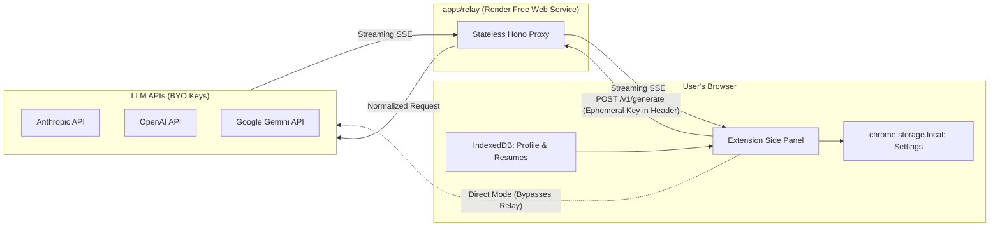

# Slayply Developer Handbook

## 1. Orientation
Welcome to **Slayply**. Slayply is an open-source, privacy-first personal Chrome side panel extension built to help job seekers turn job descriptions and application prompts into grounded, honest answers, cover letters, and outreach messages using their choice of LLM (Claude, ChatGPT, or Gemini).

### Core Tenet
**Zero automation, full agency.** Slayply never fills out forms or scrapes background tabs autonomously. The user browses, captures target text, generates grounded drafts, and manually copies answers into job portals.

---

## 2. Glossary
- **Context Pack:** A single Markdown file containing user facts, stories, and application preferences.
- **Fact ID:** A persistent identifier (e.g. `F01`, `S02`) attached to an experience bullet or project story.
- **Claim Check:** The deterministic verification step ensuring every statement in a generated response cites an authentic Fact ID.
- **Relay:** A stateless proxy service (`apps/relay`) running on Render that bridges extension requests to LLM provider APIs without persisting keys or text.
- **Direct Mode:** An optional client-side mode where the extension communicates directly with provider APIs, bypassing the relay entirely.
- **WXT:** Next-generation Web Extension Framework powered by Vite and Rollup.

---

## 3. Repo Map
```
slayply/
├── apps/
│   ├── extension/       # Chrome Side Panel MV3 extension (WXT + React + Tailwind)
│   ├── relay/           # Stateless Hono proxy server on Render (Node.js)
│   └── site/            # Static landing page & privacy documentation (planned, SITE-01)
├── packages/
│   ├── core/            # Zod schemas and validators (CORE-01), prompt builder (CORE-03); claim checker (planned)
│   ├── providers/       # LLM provider adapters: Claude built (PROV-01); OpenAI, Gemini planned
│   └── ui/              # Shared UI components & Gen-Z theme tokens (planned, THEME-01)
├── docs/                # Spec, roadmap, standards, handoff pointer; docs/adr/ holds decisions
├── .claude/             # Claude Code hooks config, skills and subagents
├── scripts/             # Workspace doctor, validation, and handoff scripts
├── .github/             # CI workflows and PR templates
├── .githooks/           # Git pre-commit, commit-msg, and pre-push hooks
├── AGENTS.md            # Master agent instructions (single source of truth)
└── turbo.json           # Turborepo task orchestration
```

---

## 4. Architecture
Slayply operates on a decoupled client-proxy architecture:
1. **Extension Client:** Handles user interactions, manages local-only IndexedDB storage (resumes, profile, history), parses PDFs with `pdf.js`, and streams generation requests.
2. **Stateless Relay:** Receives requests with ephemeral API key headers, normalizes provider APIs, and streams SSE chunks back to the client. Retains zero memory or disk state.
3. **LLM Providers:** External APIs (Anthropic, OpenAI, Google) executing inference on user-provided keys.



---

## 5. Runtime Flows
- **Health Warmup Flow (planned, `EXT-01`):** When the side panel opens, it pings `GET /health` on the relay. If asleep (Render cold start), the panel shows a warm-up animation ("cooking your answer… ☕"). If unreachable after 60s, UI invites user to switch to Direct Mode.
- **Generation & Claim Verification Flow:** (planned, `GEN-01` & `VERIF-01`)
- **Direct Mode Execution:** (planned, `DIRECT-01`)

---

### 5a. `@slayply/core` contract
- `schema.ts`: Zod schemas and inferred types for `GenerateRequest` / `GenerateResponse`. Requests are strict and bounded; responses tolerate extra keys.
- `limits.ts`: size ceilings (`LIMITS`, `MAX_PAYLOAD_BYTES`) and the `F01` / `S03` citation ID patterns.
- `validate.ts`: `validateGenerateRequest` (relay) and `validateGenerateResponse` (providers). Both take an object or JSON string and return `{ success, data }` or `{ success: false, issues, rawInput }`; the response variant adds `retryPrompt` for the single repair attempt.
- `prompt.ts` (`CORE-03`): `buildPrompt(request)` returns `{ system, messages: [user] }`. `system` is a fixed constant holding the SPEC §7 rules, the untrusted-input notice and the JSON output contract, so user data can never alter it. The user message holds `<slayply-task>`, `-job`, `-questions`, `-resume` and `-profile` blocks; facts and stories carry their `[F01]` / `[S01]` IDs, each question its `maxChars`. Any `<slayply-` tag inside user text is escaped to `&lt;slayply-` so data cannot close or forge a block. Adapters map `system` and `messages` onto their vendor format.
- Built to `dist/` by `tsc`; Turbo builds it before dependents typecheck or test.

### 5b. `@slayply/relay` (`apps/relay`, ADR-0003)
- `app.ts`: `createApp(options)` builds the Hono app from injected providers, clock, logger and config, so tests need no network. Middleware order: access log, CORS, rate limiter, routes. Routes: `GET /health`, `POST /v1/generate` (SSE `delta` / `done` / `error` events). `GET /v1/models?provider=` returns the provider's cached model list (`400` unknown provider or missing key, `501` no adapter, `401` / `429` / `503` / `502` for provider failures).
- `server.ts`: entry point; reads env via `config.ts` and registers the Claude adapter. OpenAI and Gemini answer `501 PROVIDER_NOT_IMPLEMENTED` until `PROV-02` / `PROV-03`.
- `provider.ts`: re-exports the adapter types from `@slayply/providers` and holds the key header per provider.
- Guards (ADR-0004): stream deadline 120 s (`STREAM_TIMEOUT`), at most 2 open streams per IP (`429 TOO_MANY_STREAMS`), 15 s body-read timeout (`408 REQUEST_TIMEOUT`). Provider failures become static SSE `error` codes (`UPSTREAM_AUTH`, `UPSTREAM_RATE_LIMITED`, `UPSTREAM_OVERLOADED`, `UPSTREAM_REJECTED`, `UPSTREAM_ERROR`). The provider is whichever `X-User-<Provider>-Key` header is present (exactly one).
- `cors.ts`, `client-ip.ts`, `rate-limit.ts`, `body.ts`: exact-origin check, proxy-aware client IP, in-memory fixed-window limiter (60/min, resets on restart), counting body reader (500 KB, UTF-8 only).
- Build: `tsc` to `dist/`, run with `node dist/server.js`. Env: `PORT`, `NODE_ENV`, `EXTENSION_IDS`, `TRUST_PROXY_HOPS` (see `apps/relay/.env.example`).

### 5c. `@slayply/providers` (`packages/providers`, ADR-0004)
- `types.ts`: `ProviderAdapter` (`stream`, `streamCompletion`, `listModels`), `GenerateChunk`, `ModelInfo`, `ProviderError` (kinds `auth`, `rate_limit`, `overloaded`, `invalid_request`, `upstream`, `network`; message never carries upstream text).
- `claude.ts`: `createClaudeAdapter({ fetch?, baseUrl?, browserAccess?, model?, now? })`. Streams `text_delta` events from `POST /v1/messages`; lists models from `GET /v1/models` with a 10 minute cache keyed by a SHA-256 fingerprint of the key. Uses the newest listed model unless `model` is set. Set `browserAccess` in Direct Mode to send the browser opt-in header.
- `sse.ts`: `readSse(body)` incremental SSE parser (chunk-split safe, 1 MB event cap).
- `generate.ts`: `generateValidated(adapter, request, key, signal, onDelta?)` runs the prompt, validates with `validateGenerateResponse`, retries once with `retryPrompt`, then returns `{ ok: false, rawText }`.
- Imports no `node:` module (tested), so it runs in the relay and in the extension.
- Built to `dist/` by `tsc`; the relay depends on it.

## 6. Data & Content Pipeline
- **Profile Markdown Ingestion (planned, `PROF-01`):** Parses markdown bullet points into structured facts with IDs (`F01`, `F02`).
- **Resume PDF Extraction (planned, `RES-01`):** Runs `pdf.js` inside client sandbox to produce plain text partitioned by track (FDE/SDE) and region.
- **Client Storage:** (planned, `PROF-01`, `RES-01`)

---

## 7. Testing Strategy
- **Static Analysis:** Biome checks formatting and lint rules for code and JSON (Markdown/YAML are excluded). Any finding fails `pnpm run check`.
- **Tooling Tests:** `scripts/*.test.mjs` run on Node's built-in test runner; every repo script has one.
- **Unit Testing:** Vitest tests individual Zod schemas, claim parsing algorithms, and prompt formatting in `packages/core`.
- **Recorded Fixtures (planned, `PROV-01`):** Provider adapters tested using recorded API fixture responses.
- **End-to-End (planned, `QA-01`):** Playwright tests extension panel mounting and state transitions.
- **Zero-Failure Day-One Check:** Every script or test in an unbuilt package outputs `"skip: <reason>"` and exits with 0.

---

## 8. Performance Budgets
- First-token latency < 1.5s (relay awake).
- Relay cold start transition handled gracefully with 60s timeout guard.
- Side panel memory footprint < 60 MB.
- Extension bundle size < 3.5 MB uncompressed.

---

## 9. Security Model
- **Zero Server-Side Storage (`CORE-02`):** Relay holds no database, writes no files, and logs only `[timestamp] [status] [latency_ms] [provider] [model]`. The only state is the rate-limit counter map.
- **Ephemeral Authentication (`CORE-02`):** BYOK API keys travel exclusively in HTTPS request headers, are passed to the adapter for one call and are never logged or echoed.
- **Content Security Policy (planned, `EXT-01`):** Extension enforces strict Manifest V3 CSP with zero `eval()`.
- **CORS Lockdown (`CORE-02`):** Relay accepts only `chrome-extension://<id>` for IDs in `EXTENSION_IDS` and `http://localhost:*`; any other `Origin` gets `403`. No wildcard.

---

## 10. Operations & Deployment
- **Relay (planned, `SITE-01`):** Automated deployment on Render using a root `render.yaml` blueprint.
- **Landing Site (planned, `SITE-01`):** Render Static Site deployed from `apps/site`.
- **Extension Packaging (planned, `EXT-01`):** `pnpm --filter @slayply/extension build` produces ready-to-load MV3 directory in `apps/extension/.output/chrome-mv3`.

---

## 11. How-to Recipes
- **Agent guard:** `scripts/claude-guard.mjs` is the policy engine behind the Claude Code hooks; the rules are pure functions with tests. Edit-only rules (SPEC, lockfile, generated output, `node_modules/`) still allow reads; secrets and `temp/` block reads too. Commands are checked against the *committed* state before they run, so commit and push first, then run `gh pr create` as a separate step.
- **Hooks:** installed automatically by `pnpm install` (`scripts/setup-hooks.mjs`).
- **Run the full test and lint suite:**
  ```bash
  pnpm run check
  ```
- **Check environment readiness:**
  ```bash
  pnpm run doctor
  ```
- **Build the extension for local testing (planned, `EXT-01`):**
  ```bash
  pnpm --filter @slayply/extension build
  ```
- **Load extension into Chrome (planned, `EXT-01`):**
  Navigate to `chrome://extensions`, enable Developer mode, click "Load unpacked", and select `apps/extension/.output/chrome-mv3`.

---

## 12. Decision Log
- `ADR-0001`: Monorepo Structure & Tooling (Turborepo + pnpm + Biome).
- `ADR-0002`: Shared Request/Response Schema (Zod, strict requests, tolerant responses).
- (planned, `ADR-0003` to `ADR-0005` during Phase 1 & 2).
