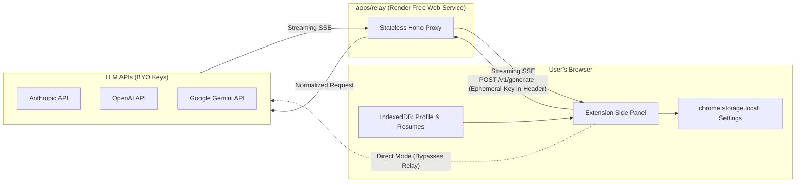

# Slayply Developer Handbook

## 1. Orientation
Welcome to **Slayply**. Slayply is an open-source, privacy-first personal Chrome side panel extension built to help job seekers turn job descriptions and application prompts into grounded, honest answers, cover letters, and outreach messages using their choice of LLM (Claude, ChatGPT, or Gemini).

### Core Tenet
**Zero automation, full agency.** Slayply never fills out forms or scrapes background tabs autonomously. The user browses, captures target text, generates grounded drafts, and manually copies answers into job portals.

---

## 2. Glossary
- **Context Pack:** A single Markdown file containing user facts, stories, and application preferences.
- **Fact ID:** A persistent identifier (e.g. `F01`, `S02`) attached to an experience bullet or project story.
- **Claim Check:** The deterministic verification step ensuring every statement in a generated response cites an authentic Fact ID.
- **Relay:** A stateless proxy service (`apps/relay`) running on Render that bridges extension requests to LLM provider APIs without persisting keys or text.
- **Direct Mode:** An optional client-side mode where the extension communicates directly with provider APIs, bypassing the relay entirely.
- **WXT:** Next-generation Web Extension Framework powered by Vite and Rollup.

---

## 3. Repo Map
```
slayply/
├── apps/
│   ├── extension/       # Chrome Side Panel MV3 extension (WXT + React + Tailwind)
│   ├── relay/           # Stateless Hono proxy server on Render (Node.js)
│   └── site/            # Static landing page & privacy documentation (planned, SITE-01)
├── packages/
│   ├── core/            # Zod schemas and validators (CORE-01); prompt builder, claim checker (planned)
│   ├── providers/       # LLM provider adapters (Claude, OpenAI, Gemini) (planned, PROV-01)
│   └── ui/              # Shared UI components & Gen-Z theme tokens (planned, THEME-01)
├── docs/                # Architecture, roadmap, standards, handoff pointers
├── scripts/             # Workspace doctor, validation, and handoff scripts
├── .github/             # CI workflows and PR templates
├── .githooks/           # Git pre-commit, commit-msg, and pre-push hooks
├── AGENTS.md            # Master agent instructions (single source of truth)
└── turbo.json           # Turborepo task orchestration
```

---

## 4. Architecture
Slayply operates on a decoupled client-proxy architecture:
1. **Extension Client:** Handles user interactions, manages local-only IndexedDB storage (resumes, profile, history), parses PDFs with `pdf.js`, and streams generation requests.
2. **Stateless Relay:** Receives requests with ephemeral API key headers, normalizes provider APIs, and streams SSE chunks back to the client. Retains zero memory or disk state.
3. **LLM Providers:** External APIs (Anthropic, OpenAI, Google) executing inference on user-provided keys.



---

## 5. Runtime Flows
- **Health Warmup Flow:** When the side panel opens, it pings `GET /health` on the relay. If asleep (Render cold start), the panel shows a warm-up animation ("cooking your answer… ☕"). If unreachable after 60s, UI invites user to switch to Direct Mode.
- **Generation & Claim Verification Flow:** (planned, `GEN-01` & `VERIF-01`)
- **Direct Mode Execution:** (planned, `DIRECT-01`)

---

### `@slayply/core` contract
- `schema.ts`: Zod schemas and inferred types for `GenerateRequest` / `GenerateResponse`. Requests are strict and bounded; responses tolerate extra keys.
- `limits.ts`: size ceilings (`LIMITS`, `MAX_PAYLOAD_BYTES`) and the `F01` / `S03` citation ID patterns.
- `validate.ts`: `validateGenerateRequest` (relay) and `validateGenerateResponse` (providers). Both take an object or JSON string and return `{ success, data }` or `{ success: false, issues, rawInput }`; the response variant adds `retryPrompt` for the single repair attempt.
- Built to `dist/` by `tsc`; Turbo builds it before dependents typecheck or test.

## 6. Data & Content Pipeline
- **Profile Markdown Ingestion:** Parses markdown bullet points into structured facts with IDs (`F01`, `F02`).
- **Resume PDF Extraction:** Runs `pdf.js` inside client sandbox to produce plain text partitioned by track (FDE/SDE) and region.
- **Client Storage:** (planned, `PROF-01`, `RES-01`)

---

## 7. Testing Strategy
- **Static Analysis:** Biome checks formatting and lint rules for code and JSON (Markdown/YAML are excluded). Any finding fails `pnpm run check`.
- **Tooling Tests:** `scripts/*.test.mjs` run on Node's built-in test runner; every repo script has one.
- **Unit Testing:** Vitest tests individual Zod schemas, claim parsing algorithms, and prompt formatting in `packages/core`.
- **Recorded Fixtures:** Provider adapters tested using recorded API fixture responses.
- **End-to-End:** Playwright tests extension panel mounting and state transitions.
- **Zero-Failure Day-One Check:** Every script or test in an unbuilt package outputs `"skip: <reason>"` and exits with 0.

---

## 8. Performance Budgets
- First-token latency < 1.5s (relay awake).
- Relay cold start transition handled gracefully with 60s timeout guard.
- Side panel memory footprint < 60 MB.
- Extension bundle size < 3.5 MB uncompressed.

---

## 9. Security Model
- **Zero Server-Side Storage:** Relay holds no database, writes no files, and never logs request or response bodies.
- **Ephemeral Authentication:** BYOK API keys travel exclusively in HTTPS request headers and are immediately discarded.
- **Content Security Policy:** Extension enforces strict Manifest V3 CSP with zero `eval()`.
- **CORS Lockdown:** Relay restricts incoming origins to the extension ID and local development server.

---

## 10. Operations & Deployment
- **Relay:** Automated deployment on Render using root `render.yaml` blueprint.
- **Landing Site:** Render Static Site deployed from `apps/site`.
- **Extension Packaging:** `pnpm --filter extension build` produces ready-to-load MV3 directory in `apps/extension/.output/chrome-mv3`.

---

## 11. How-to Recipes
- **Agent guard:** `scripts/claude-guard.mjs` is the policy engine behind the Claude Code hooks; the rules are pure functions with tests. Edit-only rules (SPEC, lockfile, generated output, `node_modules/`) still allow reads; secrets and `temp/` block reads too. Commands are checked against the *committed* state before they run, so commit and push first, then run `gh pr create` as a separate step.
- **Hooks:** installed automatically by `pnpm install` (`scripts/setup-hooks.mjs`).
- **Run the full test and lint suite:**
  ```bash
  pnpm run check
  ```
- **Check environment readiness:**
  ```bash
  pnpm run doctor
  ```
- **Build the extension for local testing:**
  ```bash
  pnpm --filter extension build
  ```
- **Load extension into Chrome:**
  Navigate to `chrome://extensions`, enable Developer mode, click "Load unpacked", and select `apps/extension/.output/chrome-mv3`.

---

## 12. Decision Log
- `ADR-0001`: Monorepo Structure & Tooling (Turborepo + pnpm + Biome).
- `ADR-0002`: Shared Request/Response Schema (Zod, strict requests, tolerant responses).
- (planned, `ADR-0003` to `ADR-0005` during Phase 1 & 2).
